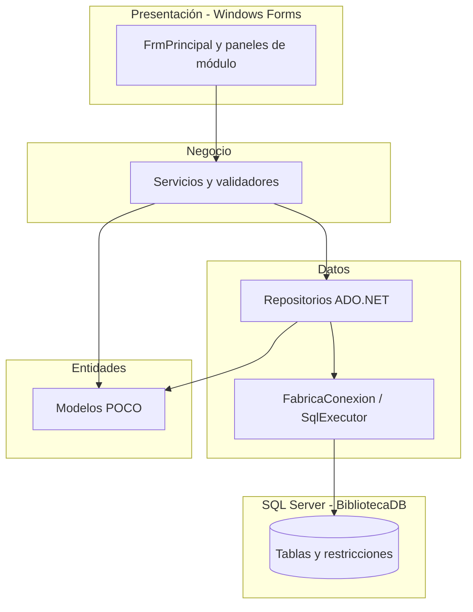

# Arquitectura del sistema

El sistema se organiza en **cuatro proyectos** que materializan una arquitectura en tres capas más el modelo de dominio.

## Responsabilidades

| Proyecto | Responsabilidad |
| --- | --- |
| `Biblioteca.Presentacion` | Formularios, navegación, captura, mensajes y presentación |
| `Biblioteca.Negocio` | Reglas de préstamos/devoluciones, validaciones y orquestación |
| `Biblioteca.Datos` | Conexión, transacciones, SQL parametrizado y repositorios |
| `Biblioteca.Entidades` | Clases del dominio compartidas entre capas |

La presentación **no** ejecuta SQL. Los repositorios **no** muestran interfaces. Las reglas de integridad de negocio (disponibilidad, duplicados, borrado protegido) viven en servicios.
