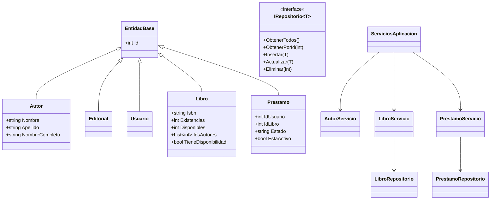

# Documento técnico

## Sistema de Gestión de Biblioteca

**Programa:** Programación Avanzada 2026  
**Tipo de entrega:** Aplicación de escritorio  
**Tecnologías:** C# · .NET 8 · Windows Forms · SQL Server · ADO.NET  
**Arquitectura:** Tres capas + entidades  
**Repositorio local:** `C:\Users\perav\Projects\SistemaBiblioteca`

---

### Portada

| Campo | Valor |
| --- | --- |
| Título | Sistema de Gestión de Biblioteca |
| Asignatura | Programación Avanzada |
| Año | 2026 |
| Plataforma | Windows |
| Lenguaje | C# |
| Interfaz | Windows Forms |
| Base de datos | SQL Server (BibliotecaDB) |

---

### Contraportada

Este documento describe el sistema implementado, no una propuesta teórica. Cada módulo, tabla, clase y regla de negocio corresponde al código fuente y a los scripts SQL del repositorio. La publicación en GitHub queda pendiente de autorización del autor del proyecto.

---

### Tabla de contenido

1. Introducción  
2. Objetivos  
3. Planteamiento del problema  
4. Análisis de requerimientos  
5. Casos de uso  
6. Diagrama de clases  
7. Modelo entidad-relación  
8. Diccionario de datos  
9. Arquitectura del sistema  
10. Descripción de módulos  
11. Conexión con SQL Server  
12. Capturas de pantalla  
13. Pruebas de funcionamiento  
14. Conclusiones  
15. Recomendaciones  
16. Referencias (APA)

---

## 1. Introducción

Una institución educativa requiere controlar el acervo bibliográfico, los lectores y el ciclo de préstamo-devolución con integridad referencial. El sistema desarrollado es una aplicación de escritorio que centraliza esas operaciones frente a SQL Server, con validaciones, transacciones y una interfaz WinForms homogénea.

El acceso a datos se realiza con consultas SQL parametrizadas mediante `Microsoft.Data.SqlClient`. No se emplea Entity Framework, ni motores distintos de SQL Server, ni interfaces web.

## 2. Objetivos

### 2.1 Objetivo general

Desarrollar una aplicación de escritorio para la gestión integral de una biblioteca utilizando C#, Windows Forms y SQL Server, que permita administrar libros, autores, editoriales y usuarios, gestionar préstamos y devoluciones, y generar reportes sobre una base de datos relacional, aplicando programación orientada a objetos.

### 2.2 Objetivos específicos

- Aplicar clases, encapsulamiento, propiedades, métodos y colecciones.
- Diseñar e implementar una base relacional normalizada (`BibliotecaDB`).
- Implementar CRUD sobre libros, autores, editoriales y usuarios.
- Controlar préstamos y devoluciones con inventario.
- Separar presentación, negocio y datos.
- Validar entradas y manejar excepciones.
- Versionar el proyecto con Git.
- Documentar el sistema de acuerdo con lo implementado.

## 3. Planteamiento del problema

Sin un sistema único, los préstamos se duplican, se prestan ejemplares no disponibles y se pierden relaciones entre libros, autores y usuarios. El problema se resuelve con un modelo relacional, reglas de negocio y una interfaz que obliga a seleccionar entidades existentes (combos y listas) en lugar de capturar identificadores sueltos.

## 4. Análisis de requerimientos

### 4.1 Funcionales

| Código | Requerimiento | Implementación |
| --- | --- | --- |
| RF01 | Gestión de libros | `PanelLibros`, `LibroServicio`, `LibroRepositorio` |
| RF02 | Gestión de autores | `PanelAutores`, `AutorServicio` |
| RF03 | Gestión de editoriales | `PanelEditoriales`, `EditorialServicio` |
| RF04 | Gestión de usuarios | `PanelUsuarios`, `UsuarioServicio` |
| RF05 | Gestión de préstamos | `PanelPrestamos`, `PrestamoServicio.Registrar` |
| RF06 | Devoluciones | `PanelDevoluciones`, `RegistrarDevolucion` |
| RF07 | Reportes | `PanelReportes` (siete consultas) |
| RF08 | Navegación | `FrmPrincipal` con menú lateral |

### 4.2 No funcionales

- Interfaz clara con identidad visual compartida (`UiTema`).
- Validación de obligatorios, longitudes, correo e ISBN.
- Mensajes de éxito, error y confirmación (`UiMensajes`).
- Consultas parametrizadas y transacciones en préstamos, devoluciones y libros-autores.
- Cadena de conexión fuera del repositorio.

## 5. Casos de uso

| Actor | Caso de uso | Resultado |
| --- | --- | --- |
| Bibliotecario | Registrar / editar / eliminar libro | Persistencia con autores y editorial |
| Bibliotecario | Buscar libro por ISBN, título o autor | Listado filtrado |
| Bibliotecario | Administrar autores y editoriales | CRUD con bloqueo si hay relaciones |
| Bibliotecario | Registrar usuario | Documento y correo únicos |
| Bibliotecario | Registrar préstamo | Descuenta `Disponibles` |
| Bibliotecario | Registrar devolución | Estado `Devuelto` y reintegro de stock |
| Bibliotecario | Consultar reportes | Grilla según el tipo elegido |
| Bibliotecario | Configurar SQL Server | Prueba de conexión y creación de BD |

## 6. Diagrama de clases

La herencia se usa en `EntidadBase` y en `PanelModulo` (controles de módulo). El polimorfismo aparece en `Recargar()` de cada panel.

## 7. Modelo entidad-relación

Véase [ModeloER.md](ModeloER.md). Resumen: `Editoriales 1–N Libros`, `Libros N–N Autores` vía `LibroAutores`, `Usuarios 1–N Prestamos`, `Libros 1–N Prestamos`.

## 8. Diccionario de datos

Véase [DiccionarioDatos.md](DiccionarioDatos.md). El script canónico es `Database/Biblioteca.sql`.

## 9. Arquitectura del sistema

Véase [Arquitectura.md](Arquitectura.md).

Flujo de un préstamo:

1. El panel construye un `Prestamo` con usuario y libro seleccionados.
2. `PrestamoServicio` verifica existencia, usuario activo, stock y préstamo duplicado.
3. `PrestamoRepositorio` abre transacción: inserta el préstamo y decrementa `Disponibles`.
4. La interfaz recarga el listado y el dashboard.

## 10. Descripción de módulos

### 10.1 Inicio

Indicadores: libros, autores, editoriales, usuarios, préstamos activos/devueltos, ejemplares disponibles y en préstamo. Grilla de préstamos activos.

### 10.2 Libros

Alta, consulta, búsqueda, edición y baja. Relación con editorial (`ComboBox`) y autores (`CheckedListBox`). Control de existencias: al editar, `Disponibles = Existencias - prestados`.

### 10.3 Autores y editoriales

CRUD con unicidad de nombre+apellido (autores) y nombre (editoriales). Eliminación bloqueada si hay libros.

### 10.4 Usuarios

Campos: Id, nombre, apellido, documento, teléfono, correo, dirección y activo. Documento y correo únicos.

### 10.5 Préstamos

Selección de usuario y libro, fechas coherentes, estado visible. Solo se editan préstamos activos. Al eliminar un activo se restaura el ejemplar.

### 10.6 Devoluciones

Lista únicamente préstamos `Prestado`. Actualiza fecha real, estado `Devuelto` e incrementa `Disponibles`.

### 10.7 Reportes

1. Listado de libros  
2. Listado de autores  
3. Listado de editoriales  
4. Listado de usuarios  
5. Préstamos activos  
6. Préstamos devueltos  
7. Historial de préstamos  

## 11. Conexión con SQL Server

La clase `ConfiguracionConexion` arma la cadena. `FabricaConexion` abre conexiones a la base y a `master`. `InstaladorBaseDatos` ejecuta los scripts por lotes `GO`.

Archivo local (no versionado):

`%AppData%\SistemaBiblioteca\connection.json`

Ejemplo versionado: `Database/connection.example.json`.

Instancias previstas:

- `(localdb)\MSSQLLocalDB` (LocalDB)
- `.\SQLEXPRESS` (Express)

Autenticación de Windows por defecto. Autenticación SQL opcional en `FrmConexion`, sin guardar secretos en Git.

## 12. Capturas de pantalla

Las evidencias visuales se almacenan en la carpeta `Evidence/` cuando se ejecuta la aplicación sobre una instancia SQL Server disponible. Las capturas deben mostrar: dashboard, CRUD de cada entidad, préstamo, devolución y un reporte.

## 13. Pruebas de funcionamiento

| Prueba | Resultado esperado |
| --- | --- |
| Compilación Release | 0 errores, 0 advertencias |
| Crear BD | Tablas y datos de prueba |
| ISBN duplicado | Mensaje de error |
| Documento duplicado | Mensaje de error |
| Prestar sin stock | Rechazo |
| Usuario inexistente | Rechazo (combo solo lista existentes) |
| Devolución | Deja de aparecer en activos |
| Eliminar autor con libros | Rechazo |
| Fechas incoherentes | Validación |

El detalle de ejecución en esta máquina se registra en el README y en la sección de evidencias a medida que SQL Server local queda operativo.

## 14. Conclusiones

El sistema cubre el alcance académico: escritorio WinForms, SQL Server, capas, POO, CRUD, préstamos, devoluciones, reportes y validaciones. El modelo relacional con `LibroAutores` evita repetir autores y mantiene la integridad. Las transacciones evitan que un préstamo quede registrado sin ajustar inventario.

## 15. Recomendaciones

- Publicar el repositorio en GitHub cuando el autor lo autorice.
- Instalar SQL Server Management Studio si se requiere administración gráfica.
- Añadir autenticación de bibliotecarios si el sistema pasa a un entorno real.
- Respaldo periódico de `BibliotecaDB`.

## 16. Referencias

American Psychological Association. (2020). *Publication manual of the American Psychological Association* (7th ed.).

Microsoft. (2024). *ADO.NET documentation*. https://learn.microsoft.com/en-us/dotnet/framework/data/adonet/

Microsoft. (2024). *Windows Forms documentation*. https://learn.microsoft.com/en-us/dotnet/desktop/winforms/

Microsoft. (2024). *SQL Server Express LocalDB*. https://learn.microsoft.com/en-us/sql/database-engine/configure-windows/sql-server-express-localdb

Microsoft. (2024). *Microsoft.Data.SqlClient*. https://learn.microsoft.com/en-us/sql/connect/ado-net/introduction-microsoft-data-sql-client-namespace
