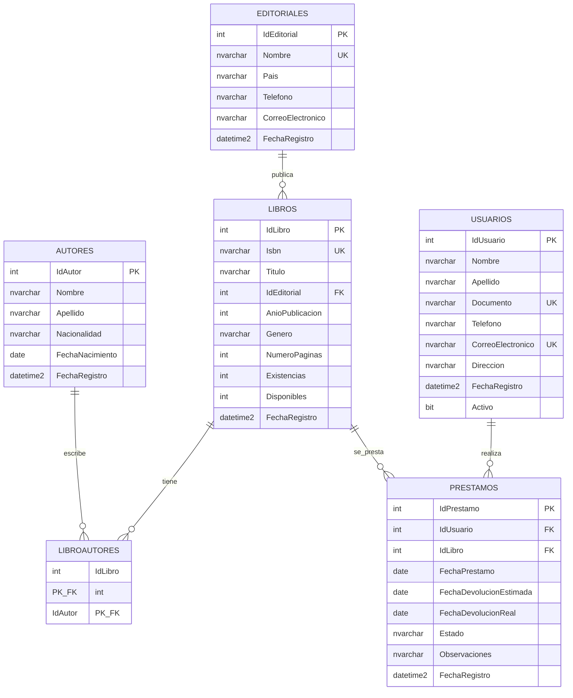

# Modelo entidad-relación

Base de datos: **BibliotecaDB**.

## Cardinalidades

- Una editorial publica muchos libros; un libro pertenece a una editorial.
- Un libro puede tener varios autores y un autor varios libros (`LibroAutores`).
- Un usuario realiza muchos préstamos; cada préstamo corresponde a un ejemplar de un libro.
- El estado del préstamo es `Prestado` o `Devuelto`. Un préstamo activo exige `FechaDevolucionReal` nula.
